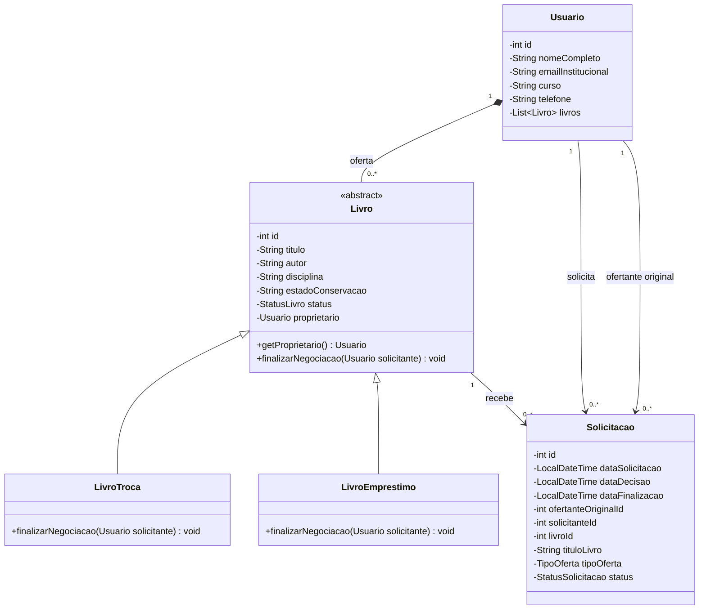
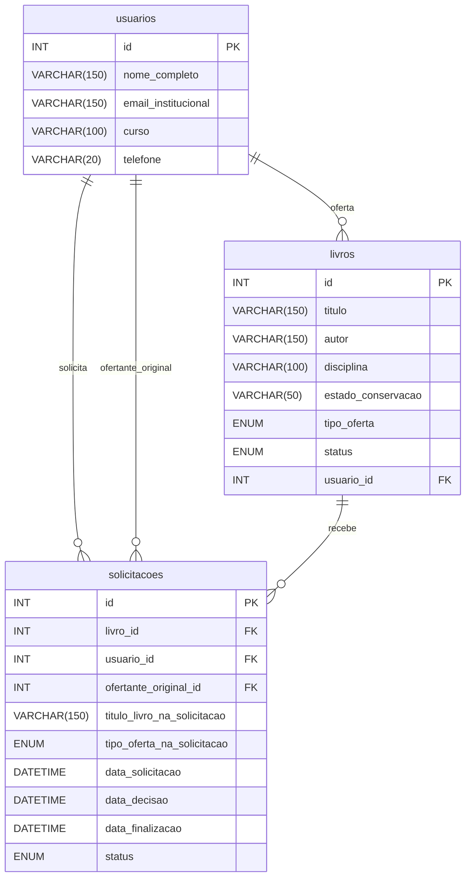

# Diagramas do Sebo Colaborativo

## Classes

Na devolução, o exemplar continua com o proprietário original. Na troca, passa à coleção do solicitante.

## Banco de dados

A tabela `livros` identifica o proprietário atual. A tabela `solicitacoes` guarda o ofertante, o solicitante, o título e o tipo de oferta da época do pedido.
