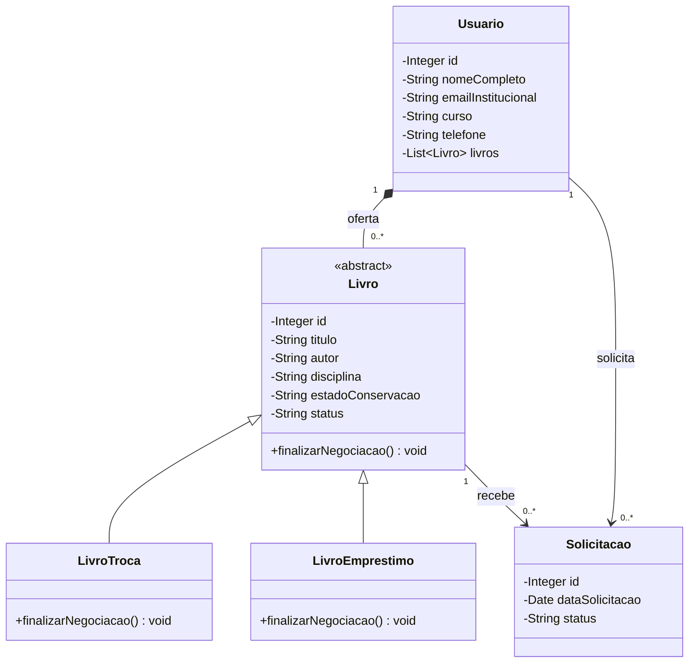
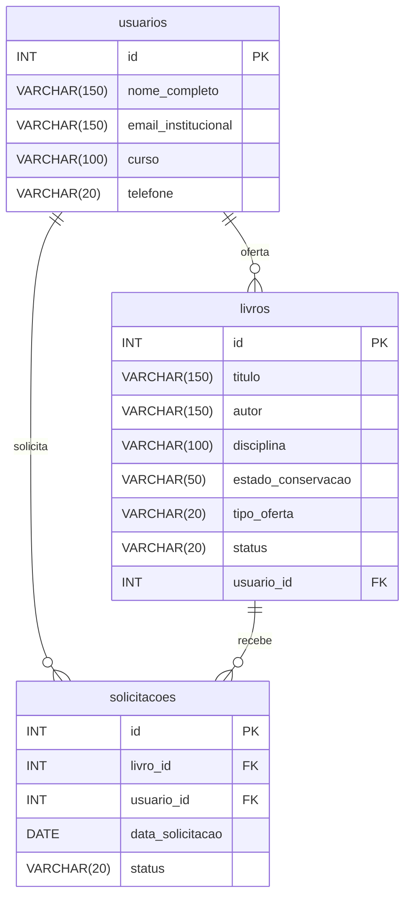

# Diagramas do planejamento

Representação editável baseada na primeira entrega. Não representa código já implementado.

## Diagrama de classes

A generalização aponta das subclasses para Livro. A composição 1:N solicitada no planejamento está explicitada entre Usuario e Livro; seu ciclo de vida precisa ser compatibilizado com a troca e o histórico antes da implementação.

- Livro será uma classe abstrata; as subclasses sobrescreverão finalizarNegociacao() com @Override.
- Cada livro terá um proprietário; um usuário poderá ter zero ou vários livros.
- A coleção de livros representa a composição prevista. O comportamento de exclusão e transferência ainda precisa ser definido.
- O polimorfismo deve produzir comportamentos coerentes com os dois tipos de negociação, não apenas duplicar métodos.
- Zero ou muitas solicitações representam o histórico; a restrição de apenas uma ativa será uma regra adicional.

## Diagrama entidade-relacionamento

No script MySQL futuro, usar tipos compatíveis entre PKs e FKs e definir a geração dos identificadores. O diagrama representa a estrutura-base da primeira entrega; a finalização e a preservação dos participantes no histórico poderão exigir campos adicionais após as [decisões pendentes](decisoes-pendentes.md).

O DER não implementa sozinho o controle de concorrência. A solução precisa garantir que duas solicitações simultâneas não mantenham negociações ativas para o mesmo livro.

## Alterações de documentação em relação ao desenho original

- Corrigida a direção das setas de herança.
- Explicitada a composição descrita no texto da primeira entrega.
- Mantidas as entidades e os campos de negócio originais.
- Usada indicação INT para os identificadores no modelo planejado para MySQL, deixando a definição física ao script.
