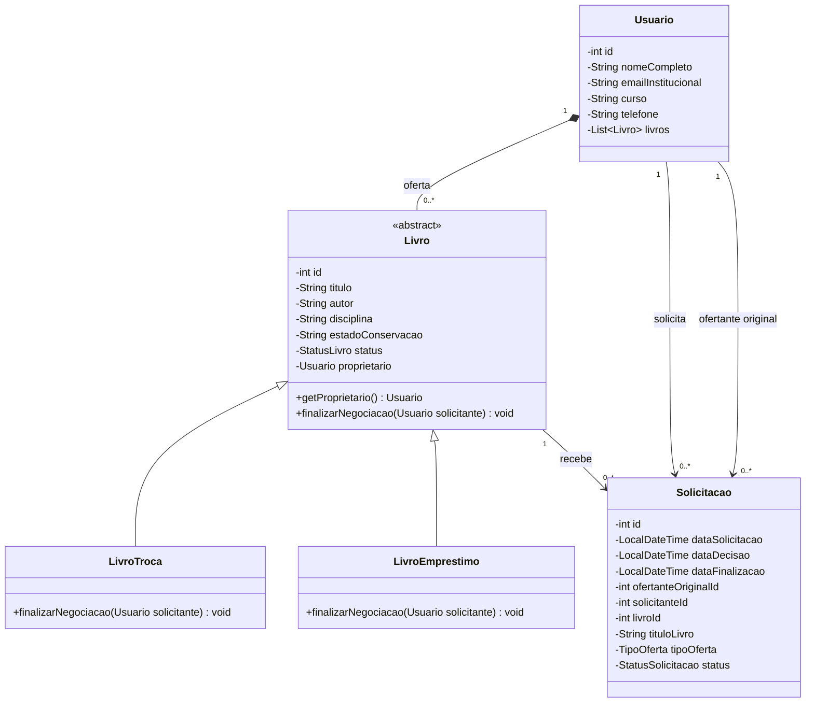
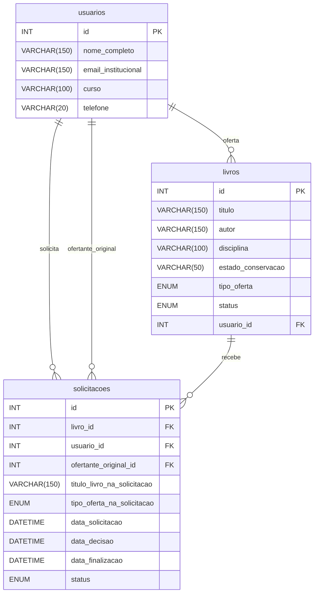

# Diagramas do projeto implementado

Representação editável do domínio implementado, preservando as relações da primeira entrega. Camadas: Menu → Service → DAO → MySQL.

## Diagrama de classes

A generalização aponta das subclasses para Livro. A composição 1:N solicitada no planejamento está explicitada entre Usuario e Livro; seu ciclo de vida segue as [regras consolidadas](regras-de-negocio.md): proprietário obrigatório, transferência entre coleções na troca e preservação das associações históricas.

- Livro é uma classe abstrata; as subclasses sobrescrevem finalizarNegociacao(Usuario solicitante) com @Override.
- Cada exemplar persistido pertence a um proprietário; um usuário pode ter zero ou vários livros.
- A coleção de livros representa a composição prevista. Na troca, o exemplar muda atomicamente de coleção; não há exclusão de usuários nem exclusão em cascata. Livro com histórico não pode ser excluído.
- O polimorfismo deve produzir comportamentos coerentes com os dois tipos de negociação, não apenas duplicar métodos.
- Zero ou muitas solicitações representam o histórico; a restrição de apenas uma ativa é validada sob bloqueio do livro no serviço.

## Diagrama entidade-relacionamento

O script database/schema.sql usa INT para PKs/FKs e AUTO_INCREMENT nos identificadores. O diagrama preserva as três entidades da primeira entrega e detalha os campos necessários à finalização e ao histórico. Em solicitacoes, usuario_id identifica o solicitante e ofertante_original_id identifica o proprietário à época; em livros, usuario_id identifica o proprietário atual. Data de decisão é preenchida no aceite ou recusa; data de finalização apenas na conclusão. Datas ainda não ocorridas permanecem nulas.

O DER não implementa sozinho o controle de concorrência. A solução precisa garantir que duas solicitações simultâneas não mantenham negociações ativas para o mesmo livro.
